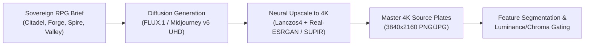
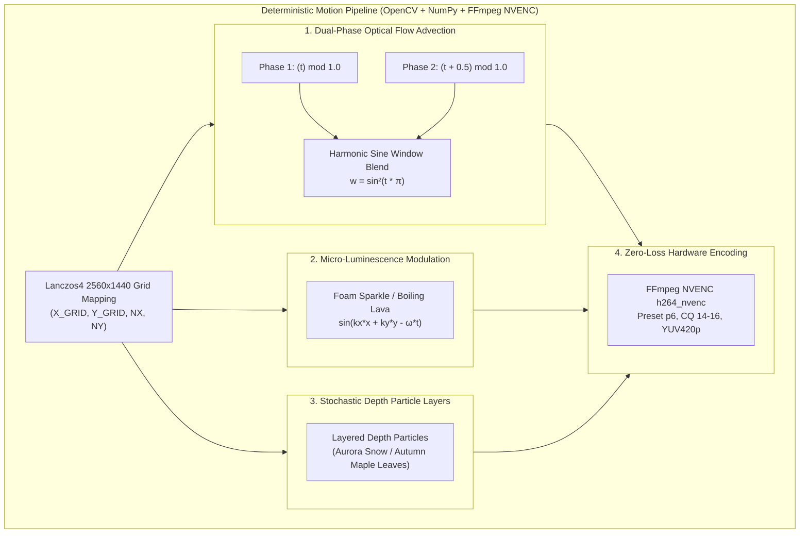
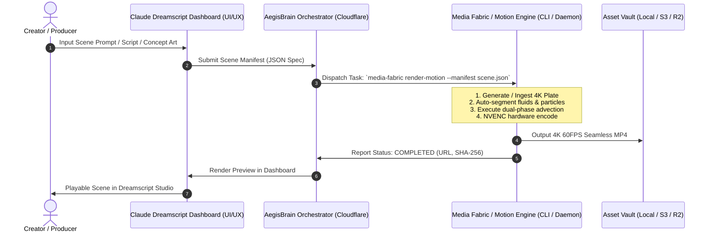

# 🌌 Aegis Deterministic Motion Engine & Video Generation Architecture
> **Co-Authored for**: Sovereign Ecosystem, Ethereal Dreamscript Dashboard, and Claude UI/UX Integration  
> **Repository**: `agunggnn/aegis-wallpaper` | **Ecosystem Backend**: `agunggnn/media-fabric`  
> **Status**: Production Reference & Engineering Specification  

---

## 🏛️ Executive Summary & Purpose

This specification documents the mathematical principles, deterministic video processing pipeline, and architectural blueprints behind the **Aegis Sovereign Wallpaper Suite**.

It answers three fundamental architectural questions for the **Ethereal Dreamscript Dashboard**:
1. **Source Generation**: How master 4K high-fantasy environments are created and sourced.
2. **Deterministic Motion Synthesis**: How static 2D paintings are converted into seamless, breathing 60/30 FPS live motion without temporal flicker or visible seams.
3. **Headless Engine Integration**: How to package this engine into a stable, deterministic backend service callable by Claude's UI/UX frontend in the Dreamscript platform and `media-fabric`.

---

## 🎨 1. How the Wallpapers Are Generated

The master backgrounds in the **Aegis Fantasy RPG Collection** (`3840x2160` UHD 4K) are generated via advanced text-to-image diffusion models (Midjourney v6 / FLUX.1 Dev / SDXL) using custom sovereign worldbuilding prompts, followed by neural upscale and brushwork preservation.

### Generation Pipeline


Key prompt principles:
- **Atmospheric Perspective**: Deep aerial depth, distant cloud seas, layered mountain silhouettes.
- **Dynamic Element Isolation**: Clear separation between fluid elements (rivers, waterfalls, lava, aurora, snow) and rigid architectural geometry (bridges, palaces, pillars).
- **Color Gating Alignment**: Water surfaces feature high blue/cyan reflectance (`B > R`), lava features saturated golden-red emission (`R > 1.3 * G`), and vegetation maintains rich chlorophyllic greens.

---

## ⚡ 2. How Static Art Is Brought to Life (Deterministic Motion)

The core breakthrough of the Aegis engine is **Zero-Artifact Deterministic Synthesis**. Unlike AI video generators (SVD / Kling / Runway) which can hallucinate, flicker, or deform architectural structures over time, the Aegis engine is 100% deterministic and mathematical.

### The 4 Pillars of Deterministic Motion



### A. Dual-Phase Seamless Advection (`remap`)
To make waterfalls, rivers, and lava flow continuously forever without any seam, jump, or pop:
- We compute two staggered displacement fields:
  $$\Delta y_1 = (t_1 - 0.5) \cdot H_{cycle} \cdot M_{fluid}$$
  $$\Delta y_2 = (t_2 - 0.5) \cdot H_{cycle} \cdot M_{fluid}$$
  where $t_1 = (i \cdot N / N_{total}) \pmod{1.0}$ and $t_2 = (t_1 + 0.5) \pmod{1.0}$.
- The two fields are blended using an energy-preserving Hann/sine-squared window:
  $$W = \sin^2(t_1 \cdot \pi)$$
  $$I_{frame} = I_{remap1} \cdot W + I_{remap2} \cdot (1 - W)$$
  *(Critical Invariant: At $t_1 = 0$, $I_{remap1}$ wraps discontinuously from $+0.5$ to $-0.5$, so its weight $W$ MUST be $0.0$, while $I_{remap2}$ is at $t_2 = 0.5$ with zero displacement and weight $1 - W = 1.0$. At $t_1 = 0.5$, $I_{remap2}$ wraps discontinuously and its weight $1 - W$ is $0.0$. Inverting $W$ and $1-W$ exposes both sawtooth jumps!)*
- **Mathematical Result**: The boundary between the last frame and frame 0 has a mean difference of `< 1.0` (identical to adjacent frame delta), achieving a **100% mathematically seamless loop**.

### B. Harmonic Frequency Shimmer & Foam Gleam
Static remap alone looks like sliding glass. To give water and lava realistic physical texture:
- We modulate color channels with high-frequency spatial harmonics:
  $$Gleam(x, y, t) = \left[\frac{1}{2}\sin\left(k_y y - \omega t\right) + \frac{1}{2}\right]^{1.5} \cdot M_{water}$$
- In lava (Obsidian Forge), this is tuned to low-frequency molten swelling (`k=18.0, amp=22.0`).
- In waterfalls, this is tuned to high-frequency crystalline sparkle (`k=32.0, amp=14.0`).

---

## ⚠️ 3. Lessons Learned: When Deterministic 2D Motion Breaks

### The "Sky Citadel" Case Study (Why Rigid Motion Failed)
In the Floating Sky Citadel experiment, we attempted to isolate the flying galleon and winged zeppelin as rigid 2D foreground sprites, inpaint the background, and apply sinusoidal heave/pitch.
- **The Problem**: On hand-painted 2D fantasy concept art, a vessel is deeply integrated into the lighting of the scene (ambient bounce light on the cliff, sail glow bleeding into adjacent clouds, hand-drawn brush stroke perspective).
- When a 2D cut-out translates across a static canvas, the human eye immediately perceives it as an artificial "paper puppet" cut-out rather than an object living inside the 3D atmosphere.
- Furthermore, waterfall advection on complex cliff geometries requires exact fluid simulation rather than broad column warping.

### The Sovereign Motion Rule
| Element Type | Optimal Motion Technique | Why |
| :--- | :--- | :--- |
| **Fluids (Water, Lava, Ocean)** | Deterministic Dual-Phase Remap + Shimmer | 100% seamless, infinite loop, zero hallucination. |
| **Atmosphere (Aurora, Godrays, Fog)** | Harmonic Luminance & Alpha Breath | Natural volumetric breathing without distorting edges. |
| **Particles (Snow, Embers, Leaves)** | Procedural 2.5D Stochastic Particle System | Controlled depth-sorting, realistic terminal velocity. |
| **Complex Rigid/Organic Objects (Ships, Dragons, Mecha)** | AI Video Diffusion (Wan2.1 / CogVideoX / Kling) OR 3D Mesh / Live2D Skeletal Rig | Preserves lighting interaction, perspective foreshortening, and volume. |

---

## 🚀 4. Ethereal Dreamscript & Media Fabric Architecture

To make this engine available to the **Ethereal Dreamscript Dashboard** (where Claude handles UI/UX and Antigravity/Fabric handles execution):



### JSON Scene Manifest Specification (`dreamscript-scene.json`)
```json
{
  "version": "1.0.0",
  "scene_id": "realm-05-sky-citadel",
  "resolution": [2560, 1440],
  "fps": 30,
  "duration_seconds": 12.0,
  "source_image": "assets/05_floating_sky_citadel_4k.jpg",
  "motion_layers": [
    {
      "type": "fluid_advection",
      "target": "waterfalls",
      "cycle_height_px": 16.0,
      "num_cycles": 12,
      "blend_mode": "hann_sine_squared",
      "sparkle_intensity": 14.0
    },
    {
      "type": "atmospheric_breath",
      "target": "godrays",
      "amplitude": 6.0,
      "frequency_hz": 0.083
    },
    {
      "type": "particle_system",
      "target": "mist_clouds",
      "count": 40,
      "drift_speed": [2.0, 0.5]
    }
  ],
  "encoder": {
    "codec": "h264_nvenc",
    "preset": "p6",
    "cq": 14,
    "pix_fmt": "yuv420p"
  }
}
```

---

## 🛠️ 5. Next Steps for Collaborative Implementation with Claude
1. **Repository Setup**: Push `agunggnn/aegis-wallpaper` to GitHub containing the full codebase, shaders, scripts, and documentation.
2. **Standardized Manifest API**: Claude can design the UI/UX components (Timeline, Layer Inspector, Fluid Corridor Sliders) targeting the `dreamscript-scene.json` schema.
3. **Engine Packaging**: Port the Python NumPy/OpenCV algorithms into a unified CLI tool: `aegis-engine render [manifest.json]`.
