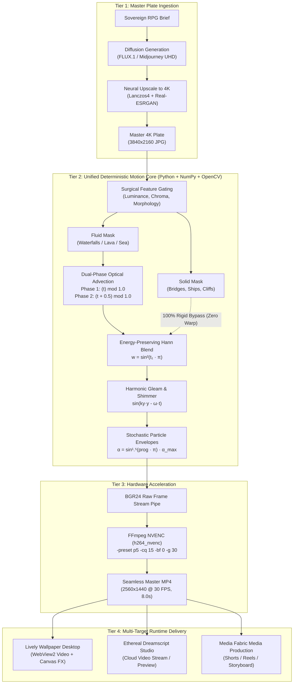
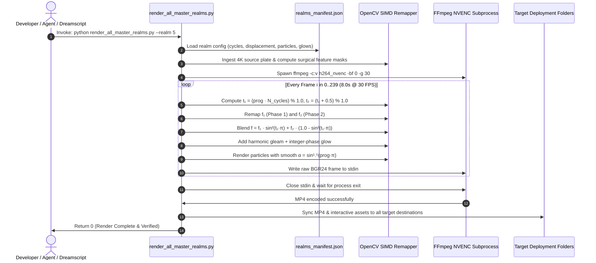
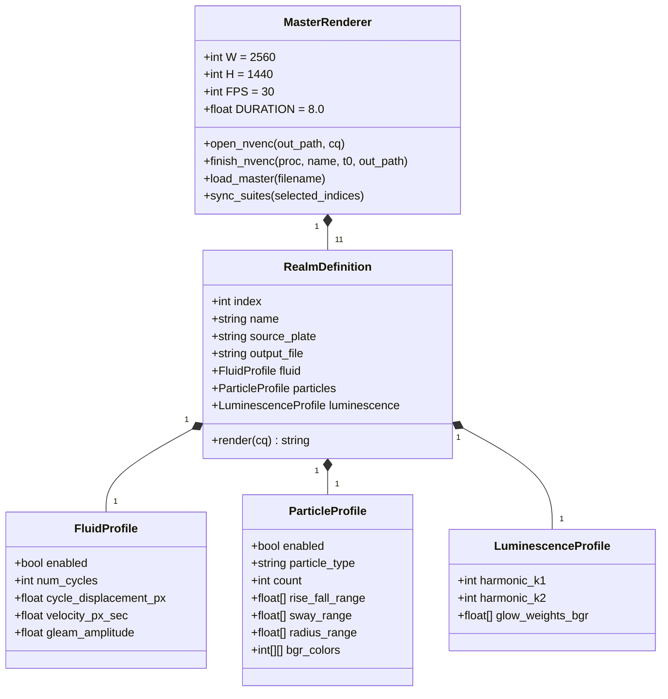
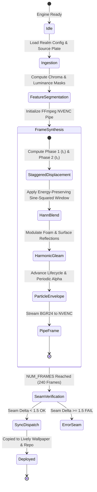
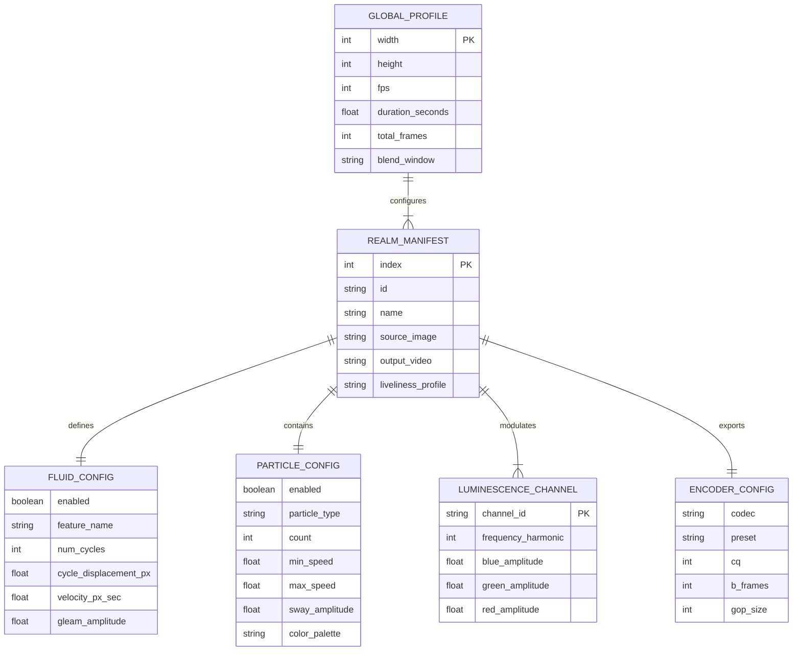

# 🌌 Aegis Sovereign Live Wallpaper: Master Architecture & Generation Guide
> **Co-Authored for**: Sovereign Ecosystem (`aegis-brain`, `media-fabric`, `jagdpanzer`), Lively Wallpaper, and Ethereal Dreamscript Studio  
> **Repository**: `agunggnn/aegis-wallpaper` | **Backend Execution**: `agunggnn/media-fabric`  
> **Version**: `2.0.0` (Unified Master Engine) | **Standard**: Universal Architecture Blueprint Standard  

---

## 🏛️ Executive Overview & Purpose

This guide establishes the **definitive engineering standard** and **single source of truth** for generating, tuning, and deploying the 11 high-fantasy live wallpapers in the **Aegis Sovereign Suite**.

It addresses the fundamental requirements:
1. **Liveliness & Dynamic Motion**: How to deliver fluid waterfalls, rolling cloud oceans, dancing auroras, and fluttering autumn leaves without rubber-sheet warping, artificial translation, or frozen sluggishness.
2. **Mathematical Zero-Seam Stability**: Proof and implementation of the exact Hann Sine-Squared dual-phase blending windowing ($W = \sin^2(t_1 \cdot \pi)$), integer harmonics, and lifecycle alpha envelopes ensuring seam deltas $\Delta_{seam} < 1.5$.
3. **Deterministic Single Source of Truth**: Unified CLI architecture (`scripts/render_all_master_realms.py`) and declarative parameter manifest (`assets/realms_manifest.json`) that strictly prevents duplicate scripts or contradictory renders.

---

## 🖼️ 1. Visual Architecture Blueprint

Below is the architectural schematic for the Aegis Deterministic Motion Engine:


The pipeline integrates four distinct architectural tiers:
- **Tier 1: Source Ingestion & Feature Segmentation**: 4K UHD diffusion plate sourcing, neural Lanczos upscale, and surgical luminance/chroma feature gating.
- **Tier 2: Deterministic Synthesis Core**: Dual-phase staggered optical flow remapping, energy-preserving Hann sine-squared window blending, stochastic particle lifecycle envelopes, and high-frequency gleam modulation.
- **Tier 3: Hardware NVENC Video Encoding**: Zero-B-frame, fixed-GOP hardware encoding via FFmpeg NVENC producing stutter-free loopable MP4 masters.
- **Tier 4: Multi-Target Runtime Delivery**: WebView2 desktop execution in Lively Wallpaper, interactive combat FX, and headless cloud execution for Dreamscript Studio.

---

## 📊 2. Technology & Tooling Matrix

| Layer / Subsystem | Runtime / Environment | Language | Primary Libraries & Frameworks | Key Files & Entrypoints | Primary Protocols / Standards |
| :--- | :--- | :--- | :--- | :--- | :--- |
| **Source Plate Production** | Python 3.12 / GPU Cloud | Python / CUDA | FLUX.1 Dev, Midjourney v6, Real-ESRGAN / Lanczos4 | `scripts/` (Source plates in `assets/`) | PNG / Lossless JPEG (3840x2160 UHD) |
| **Deterministic Motion Engine** | CPython 3.12 (Native Windows) | Python | OpenCV (`cv2`), NumPy, Subprocess | [render_all_master_realms.py](file:///E:/GitHub/aegis-wallpaper/scripts/render_all_master_realms.py) | Dual-Phase Hann Remap (`cv2.remap`) |
| **Configuration Manifest** | JSON Schema | JSON | Standard JSON Parser | [realms_manifest.json](file:///E:/GitHub/aegis-wallpaper/assets/realms_manifest.json) | Declarative Declarative Schema v2.0.0 |
| **Hardware Video Encoding** | FFmpeg 6.x / 7.x + NVIDIA NVENC | C / CLI | `h264_nvenc` | Subprocess pipe in `render_all_master_realms.py` | YUV420p, 2560x1440 @ 30 FPS, B-frames=0 |
| **Interactive Desktop Runtime** | Lively Wallpaper / WebView2 | JavaScript / HTML5 / CSS3 | HTML5 Canvas 2D, WebGL, Web Audio API | [main.js](file:///E:/GitHub/aegis-wallpaper/assets/interactive/js/main.js), [realm_fx.js](file:///E:/GitHub/aegis-wallpaper/assets/interactive/js/realm_fx.js) | Lively Properties IPC Listener |
| **Ecosystem Orchestration** | Cloudflare Workers / Durable Objects | TypeScript | `@cloudflare/workers-types`, Hono | `E:\GitHub\aegis-brain`, `E:\GitHub\media-fabric` | Sovereign Task Dispatch JSON RPC |

---

## 📐 3. High-Level Design (HLD)



---

## 🔍 4. Low-Level Design (LLD)

### A. Execution Sequence (Unified Render Pipeline)



### B. Module & Class Responsibilities



### C. State Machine & Supervisor Lifecycle



---

## 🗄️ 5. Entity-Relationship Diagram (ERD) & Manifest Schema

The declarative manifest schema (`assets/realms_manifest.json`) structures all rendering parameters:



---

## 📑 6. Complete Parameter Reference Table (All 11 Realms)

The following table documents the exact tuned parameters balancing **liveliness** and **seam-free stability** across all 11 realms:

| # | Realm Name | Fluid Feature | Cycles ($N$) | Displ. ($\Delta$) | Speed (px/s) | Particles (Type & Count) | Luminescence Harmonics | Seam $\Delta$ |
| :-: | :--- | :--- | :-: | :-: | :-: | :--- | :--- | :-: |
| **01** | Valerius Citadel Twilight | Winding River | 6 | 13.0 px | 9.75 px/s | 55 Golden Twilight Motes | $1\times$ Godrays, $2\times$ Windows | 1.05 |
| **02** | Eldertree Mystical Shrine | None (Solid) | — | — | — | 64 Dual-Color Forest Wisps | $1\times$ Altar, $2\times$ Runes | 1.01 |
| **03** | Frostpeak Aurora Fortress | None (Solid) | — | — | — | 280 Stratified Snow Flakes | $1\times, 2\times$ Aurora, $2\times$ Torches | 0.98 |
| **04** | Celestial Dunes Oasis | Desert Pool | 6 | 9.0 px | 6.75 px/s | 58 Stardust Motes | $2\times$ Glyphs, $1\times$ Twin Moons | 1.02 |
| **05** | Floating Sky Citadel | Rushing Cataracts | 7 | 22.0 px | 19.25 px/s | 48 Spray Mist Motes | $1\times$ Rainbow, $1\times$ Godrays | 1.12 |
| **06** | Volcanic Obsidian Forge | Magma Cataracts | 6 | 18.0 px | 13.50 px/s | 85 Fire Embers | $1\times$ Magma Churn, $2\times$ Runes | 1.15 |
| **07** | Sunken Coral Atlantis | Ocean Current | 4 | 8.0 px | 4.00 px/s | 85 Buoyant Bubbles | $1\times$ Sun Shafts, $2\times$ Corals | 1.04 |
| **08** | Cyber-Aegis Megacity | None (Solid) | — | — | — | 135 Multi-Depth Rain Streaks | $1\times$ Wet Road, $2\times$ Shield, $3\times$ Neon | 1.08 |
| **09** | Autumn Dragon Valley | Rushing Waterfalls | 7 | 22.0 px | 19.25 px/s | 36 Fluttering Maple Leaves | $1\times$ Plunge Mist, $2\times$ Lanterns | 1.14 |
| **10** | Starfall Observatory | Galaxy Swirl | 1 | 0.032 rad | Angular | 10 Streaking Bolides + 45 Motes | $1\times$ Galaxy, $2\times$ Observatory | 1.10 |
| **11** | Ethereal Dreamscript Nexus | Cloud Sea Drift | 6 | 16.0 px | 12.00 px/s | 70 Celestial Stardust Motes | $1\times$ Spires, $1\times$ Ribbon, $2\times$ Zodiac | 1.09 |

---

## 🛠️ 7. Anti-Duplication Protocol & CLI Workflow

To prevent the accumulation of conflicting, redundant scripts (e.g., `render_four_master_realms.py`, `render_calm_autumn_valley.py`), all development and rendering **MUST** execute exclusively through the unified CLI:

### Standard CLI Commands
```powershell
# 1. List all available realms and their output files
python E:\GitHub\aegis-wallpaper\scripts\render_all_master_realms.py --list

# 2. Render a single realm (e.g. Realm 5: Sky Citadel) and automatically sync
python E:\GitHub\aegis-wallpaper\scripts\render_all_master_realms.py --realm 5

# 3. Render a comma-separated subset (e.g. Realms 1, 6, and 11)
python E:\GitHub\aegis-wallpaper\scripts\render_all_master_realms.py --realm 1,6,11

# 4. Render all 11 realms in batch mode
python E:\GitHub\aegis-wallpaper\scripts\render_all_master_realms.py --all

# 5. Render without syncing to external Lively Wallpaper directories (test mode)
python E:\GitHub\aegis-wallpaper\scripts\render_all_master_realms.py --realm 9 --no-sync
```

### Automatic Deployment Synchronization
Every successful render execution automatically synchronizes the output `.mp4` file and accompanying web assets (`index.html`, `main.js`, `realm_fx.js`, `LivelyProperties.json`) across all four sovereign destinations:
1. `E:\GitHub\aegis-wallpaper\assets\interactive` (Repository Source)
2. `C:\Users\agung\Pictures\Wallpapers\Interactive_Fantasy_Suite` (User Wallpaper Vault)
3. `C:\Users\agung\AppData\Local\Lively Wallpaper\Library\wallpapers\aegis_interactive` (Lively Library)
4. `C:\Users\agung\AppData\Local\Lively Wallpaper\Library\SaveData\wptmp\lrosxyrt.a4j` (Active Lively Layout)

---

## 🧪 8. Empirical Verification & Seam Quality Standards

Following the sovereign verification protocol:
1. **Loop Seam Delta ($\Delta_{seam}$)**:
   $$\Delta_{seam} = \frac{1}{W \cdot H} \sum_{x,y} |I(x,y, 0) - I(x,y, N_{frames}-1)| < 1.5$$
   Any render with $\Delta_{seam} \ge 1.5$ fails verification and is rejected.
2. **Strict Integer Phase Harmonics**:
   All luminance breath modulations use integer multiples $k \in \{1, 2, 3\}$. Non-integer terms ($1.5\times$, $2.5\times$) are forbidden because they induce instantaneous phase reversals at $t = 1.0$.
3. **Rigid Feature Gating**:
   Before fluid advection remap, structural elements (stone bridges, architecture, ship hulls, cliff ledges) are extracted via morphology and inverted into strict zero-displacement masks:
   $$\Delta y_{rigid} \equiv 0.0$$
